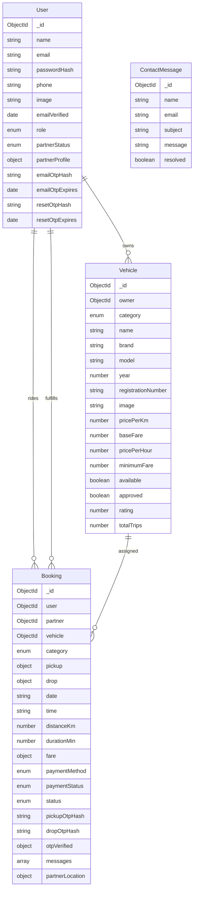
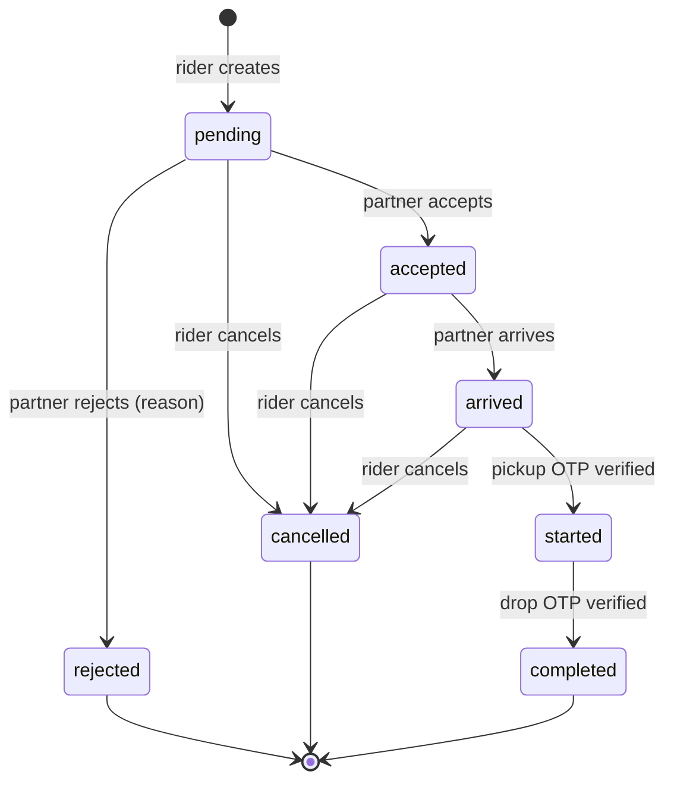
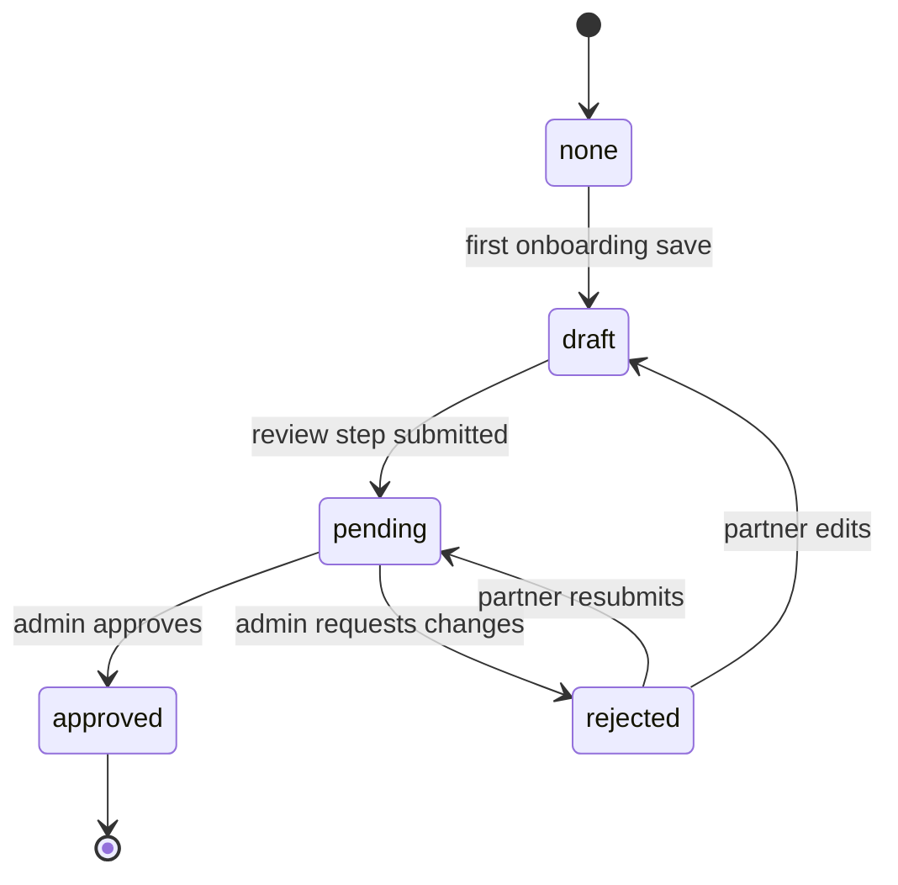

# Architecture

This document explains how RYDEX is put together: the processes involved, the source layout, the request and page lifecycles, the data model, the booking and onboarding state machines, realtime delivery, money handling, and the security boundaries.

## 1. Design goals

RYDEX is a multi-vendor vehicle booking marketplace. Riders book bikes, cars, autos, loading vehicles and trucks from independent partners. Partners complete a review-backed onboarding flow, manage a fleet, accept rides and track earnings. Admins review partners, monitor the marketplace and inspect every booking.

The implementation follows a few deliberate rules:

1. **Keep the demonstrated stack.** Next.js App Router, TypeScript, MongoDB/Mongoose, Auth.js v5, Socket.IO, Razorpay, Cloudinary, ZEGOCLOUD, Leaflet and Redux Toolkit are all used as shown in the source series.
2. **One Next.js runtime, workspace boundaries.** The repository is an npm-workspaces monorepo: the Next.js project lives in `frontend`, server-only domain code in `backend`, and isomorphic code in `shared`. The web app and the standalone Socket.IO process reuse the same server package instead of duplicating business logic.
3. **The server is authoritative.** Fares, distances, booking state, roles, ownership, vehicle approval and payout details are validated or derived on the server. The browser never decides a price or a status transition.
4. **Optional integrations degrade cleanly.** Maps, email, uploads, payments, video KYC and realtime each have a documented fallback so local development works without paid credentials.
5. **Failure is visible.** API errors use a consistent shape, dashboards show loading/empty/error states, and realtime failures fall back to polling instead of silently breaking the page.
6. **Security defaults over demo shortcuts.** Passwords and OTPs are hashed, payout account numbers are encrypted, production never returns OTPs, and every mutating endpoint re-checks the session and the database.

## 2. Runtime topology

RYDEX has three runtime components and a set of optional external services.

```text
                        ┌────────────────────────────────────────────┐
                        │                 Browser                    │
                        │  React Server Components + client islands  │
                        │  Socket.IO client · Leaflet · Razorpay.js  │
                        └───────────────┬───────────────┬────────────┘
                                        │ HTTPS         │ WebSocket / polling
                                        ▼               ▼
┌──────────────────────────────────────────────┐  ┌──────────────────────────┐
│ Next.js web app (:3000)                       │  │ Socket.IO server (:4001) │
│                                               │  │                          │
│ frontend/src/app   pages, layouts, adapters   │  │ HMAC token check         │
│ backend/src        Auth.js, APIs, models      │  │ user/booking rooms       │
│ frontend/src       UI, Redux, client helpers  │  │ /health  /emit           │
│ shared/src         types, validation, fares   │  │                          │
└───────┬───────────────────────┬───────────────┘  └────────────▲─────────────┘
        │                       │                               │
        │ Mongoose              │ server-side fetch             │ POST /emit
        ▼                       ▼                               │ (internal secret)
┌───────────────┐   ┌───────────────────────────────┐           │
│ MongoDB       │   │ External services             │           │
│ Atlas / local │   │ · Geoapify / Nominatim / OSRM │───────────┘
└───────────────┘   │ · Cloudinary                  │
                    │ · Gmail SMTP / dev outbox     │
                    │ · Razorpay                    │
                    │ · ZEGOCLOUD                   │
                    └───────────────────────────────┘
```

| Process | Port | Responsibility | Hosting |
| --- | --- | --- | --- |
| Next.js web | `3000` | Pages, Auth.js, all HTTP APIs, server-side rendering | Vercel or any Node 20.9+ host |
| Socket.IO | `4001` | Persistent connections, rooms, realtime fan-out | Render/Railway/Fly.io/VPS; **not** Vercel |
| MongoDB | `27017` local / Atlas | Persistence | Local MongoDB or Atlas |

The Socket.IO server is separate because serverless platforms do not support long-lived WebSocket processes. The Next.js app talks to it in two ways:

- **Browser to socket:** the browser requests a short-lived signed token from `GET /api/socket/token`, then connects directly to `NEXT_PUBLIC_SOCKET_URL`.
- **API route to socket:** backend handlers call `emitSocketEvent()`, which POSTs to `SOCKET_EMIT_URL/emit` with the `x-socket-secret` header.

If either URL is empty in production, realtime emits are skipped and the browser polling fallback keeps dashboards current.

## 3. Repository layout

```text
rydex/                              npm workspaces root
├─ frontend/                        Next.js app workspace (@rydex/frontend)
│  ├─ public/                       Brand, hero, vehicle and icon assets
│  ├─ src/
│  │  ├─ app/                       Next.js App Router
│  │  │  ├─ api/                    Thin adapters; re-export backend handlers
│  │  │  ├─ book/ bookings/ fleet/  Public booking journey
│  │  │  ├─ dashboard/              Rider, partner and admin dashboards
│  │  │  ├─ login/ forgot-password/ Auth pages
│  │  │  ├─ terms/ privacy/ contact/ Legal and support pages
│  │  │  └─ layout.tsx page.tsx     Root shell and cinematic home page
│  │  ├─ components/                Public, booking and dashboard components
│  │  ├─ hooks/                     useBookingSocket
│  │  ├─ lib/                       client-api, category icons
│  │  └─ redux/                     Store, hooks, UI slice
│  ├─ next.config.ts                Turbopack root, tracing root, env loading
│  └─ package.json
├─ backend/                         Server workspace (@rydex/backend)
│  ├─ src/
│  │  ├─ auth.ts                    Auth.js v5 configuration
│  │  ├─ http/routes/               HTTP handler implementations
│  │  ├─ lib/                       DB, guards, crypto, OTP, email, socket, geo, uploads, KYC, env loader
│  │  ├─ models/                    User, Vehicle, Booking, Contact schemas
│  │  ├─ scripts/seed.ts            Idempotent demo data
│  │  ├─ scripts/create-admin.ts    Production admin bootstrap
│  │  └─ socket/server.ts           Standalone Socket.IO process
│  └─ package.json
├─ shared/                          Isomorphic workspace (@rydex/shared)
│  ├─ src/
│  │  ├─ constants.ts               Categories, fare config, statuses
│  │  ├─ fare.ts                    Fare and distance math
│  │  ├─ types/                     Shared domain types and Auth.js augmentation
│  │  ├─ utils.ts                   INR/date/class helpers
│  │  ├─ validation.ts              Zod schemas used by APIs and forms
│  │  └─ __tests__/                 Fare, validation and utility tests
│  └─ package.json
├─ docs/                            Architecture, environment, deployment, testing, comparison
├─ .env                             Single local configuration file (ignored by Git)
├─ .env.example                     Documented environment template
├─ package.json                     Workspaces and orchestration scripts
├─ tsconfig.base.json               Shared compiler options
└─ vitest.config.mts                Root test runner and workspace aliases
```

```text
frontend/src/app/api/**/route.ts  →  backend/src/http/routes/**/route.ts
frontend/src/**                   →  @rydex/shared/* (types, validation, fare, utils)
backend/src/**                    →  @rydex/shared/* and @rydex/backend/*
```

### Layer boundaries

| Layer | May import | Must not import |
| --- | --- | --- |
| `shared/src` | Other `shared` modules | `frontend`, `backend`, `app` |
| `backend/src` | `@rydex/shared/*`, backend modules, Node APIs | `frontend` components, Redux |
| `frontend/src` | `@rydex/shared/*`, frontend modules, `next/navigation`, browser APIs | Backend models, secrets, Node-only modules |
| `frontend/src/app` | Pages import frontend components; route adapters import backend handlers | Business logic directly (keep adapters thin) |

The `frontend/src/app/api/**/route.ts` files are one or two lines, for example:

```ts
// frontend/src/app/api/bookings/route.ts
export { GET, POST } from "@rydex/backend/http/routes/bookings/route";
```

Next.js requires these route files to live under the Next.js project root, so they remain thin adapters while the implementation lives in the backend workspace. Next.js 16 passes route params as a promise; the backend handlers type them accordingly. `frontend/next.config.ts` sets `turbopack.root` and `outputFileTracingRoot` to the monorepo root, adds both workspace packages to `transpilePackages`, and loads the root `.env` explicitly.

## 4. Request lifecycle

### HTTP API request

1. **Adapter** - Next.js matches `frontend/src/app/api/**/route.ts` and calls the re-exported handler.
2. **Rate limit** (where applicable) - `rateLimit()` checks an in-memory bucket keyed by IP and sometimes user ID.
3. **Authentication** - `requireUser()` calls Auth.js `auth()`, then re-reads the user from MongoDB so a role change or deleted account takes effect immediately.
4. **Authorization** - `requireRole()` or explicit ownership checks (rider, partner, admin) run before any mutation.
5. **Validation** - Zod schemas in `shared/src/validation.ts` parse the body or query. Errors return `422` with the first friendly issue.
6. **Domain operation** - Fare recalculation, availability checks, state transition guards, uniqueness checks and encryption happen here.
7. **Persistence** - Mongoose writes/aggregates.
8. **Side effects** - Email and realtime emits are best-effort and wrapped so a failure cannot roll back a successful booking or review.
9. **Response** - JSON with `{ ok: true, ... }` or `{ ok: false, error }`. Unexpected errors become `500` and hide internals in production.

```ts
// Typical handler shape
export async function POST(request: Request) {
  try {
    const user = await requireUser();
    const limit = rateLimit(`booking:${clientIp(request)}`, 8, 60_000);
    if (!limit.allowed) return jsonError("Too many booking attempts. Please wait a minute.", 429);

    const parsed = bookingSchema.safeParse(await request.json());
    if (!parsed.success) return jsonError(parsed.error.issues[0]?.message || "Check your booking details.", 422);

    // server-derived route, fare and OTP...
    return NextResponse.json({ ok: true, booking }, { status: 201 });
  } catch (error) {
    return handleApiError(error);
  }
}
```

### Page request

1. The root layout mounts fonts, providers (Auth.js session, Redux, Sonner) and global styles.
2. `frontend/src/app/dashboard/layout.tsx` calls `auth()` and redirects unauthenticated visitors to `/login?callbackUrl=/dashboard`.
3. `frontend/src/app/dashboard/admin/layout.tsx` and `frontend/src/app/dashboard/partner/layout.tsx` add role checks.
4. Partner pages use `requireApprovedPartnerPage()`; the onboarding page uses `requireOnboardingPage()`.
5. Other dashboard pages hydrate from client components that call `/api/...` and show skeletons while loading.

The dashboard shell is a client component that renders the role-specific navigation and account menu. It receives the session user as a prop from the server layout.

## 5. Authentication and authorization

### Providers

- **Credentials** - email + password. Passwords are bcrypt hashes (cost 12).
- **Google OAuth** - enabled only when `AUTH_GOOGLE_ID` and `AUTH_GOOGLE_SECRET` are set. The button is hidden when disabled.

Auth.js uses JWT sessions with a 30-day lifetime. The JWT is not trusted for role or profile data on its own: the `session` callback re-reads the user from MongoDB on each session lookup, so admin approval, rejection, role switching and profile updates are reflected without a re-login.

### Registration and email verification

1. `POST /api/auth/register` normalizes the email, validates the password, checks for duplicates, hashes the password, generates a six-digit OTP, stores only its SHA-256 hash + 10-minute expiry, and emails the code.
2. `POST /api/auth/verify-email` compares the hash in constant time, marks `emailVerified`, clears the OTP fields, and returns a success state. Invalid/expired codes are rejected.
3. `POST /api/auth/resend-otp` issues a new code with a fresh expiry, rate limited per IP.
4. Sign-in is blocked with `EMAIL_NOT_VERIFIED` until the address is verified. The client routes the user to `/verify-email`.

OTP hashes are peppered with `AUTH_SECRET`. In development, `devOtpField()` may include the code in the response when email is not configured; in production it always returns `{}` and the code is never exposed. Booking creation similarly returns `devPickupOtp` only outside production.

### Password reset

`POST /api/auth/forgot-password` always returns a generic response so it cannot be used to enumerate accounts. It stores a reset OTP hash and emails the code when the account exists. `POST /api/auth/reset-password` verifies the code and expiry, hashes the new password, clears the reset fields, and leaves existing sessions to expire naturally.

### Authorization matrix

| Capability | Rider | Partner | Admin |
| --- | --- | --- | --- |
| Browse public fleet | ✓ | ✓ | ✓ |
| Create booking | ✓ (not own vehicle) | ✓ (not own vehicle) | ✓ |
| View own bookings | ✓ | Partner rides only | All |
| Accept/reject request | - | ✓ | Override |
| Move arrived → started → completed | - | ✓ | Override |
| Cancel booking | ✓ (pending/accepted/arrived) | - | ✓ |
| Rate completed ride | ✓ (once) | - | ✓ |
| Manage own fleet | - | ✓ (approved) | - |
| Onboarding | - | ✓ (not pending/approved) | - |
| Review vendors | - | - | ✓ |
| Admin dashboards | - | - | ✓ |

Server checks are authoritative. UI affordances are conditional, but hiding a button is never the security boundary.

### Role switching

`PATCH /api/user/role` switches a non-admin account between `user` and `partner`. It never grants admin. If the user has an approved partner profile, switching to partner routes to the partner dashboard; otherwise it routes to onboarding. The partner onboarding flow also promotes `role` to `partner` on its first save.

## 6. Data model



### User

- `email` is unique and lowercased.
- `passwordHash`, `emailOtpHash`, `emailOtpExpires`, `resetOtpHash` and `resetOtpExpires` use `select: false`. Routes that need them must opt in explicitly, which prevents accidental leakage in generic queries.
- `role` is `user | partner | admin`.
- `partnerStatus` is `none | draft | pending | approved | rejected`.
- `partnerProfile` is an embedded document with the vehicle draft, document URLs, encrypted bank details, KYC metadata, pricing and review timestamps.
- Indexes: unique `email`, `role`, `partnerStatus`.

### Vehicle

- `registrationNumber` is unique, uppercased and trimmed.
- Public listing requires `approved: true` and `available: true`; the fleet API filters on both.
- Indexes support category/availability browsing and a text index over name, brand, model and description.
- `rating` is a rolling average updated after each rating; `totalTrips` increments on completion.

### Booking

- References rider, partner and vehicle.
- Stores a snapshot of the category, route, distance/duration and fare breakdown so later price changes do not rewrite history.
- `pickupOtpHash` and `dropOtpHash` use `select: false`; only the server can verify them.
- `messages` is an embedded array of chat messages with a sender reference and 1,000-character limit.
- `partnerLocation` stores the most recent live location plus timestamp.
- Indexes: rider + created date, partner + status + created date, status + created date.

### ContactMessage

Stores contact form submissions for support. Delivery also goes to email/the dev outbox; the database copy is the durable record.

## 7. Booking lifecycle



### Creation

- The rider picks an available, approved vehicle, a future date/time, pickup/drop and cash or online payment.
- `isFutureRide()` requires at least five minutes of lead time.
- The backend recalculates the route with OSRM (or a haversine estimate if OSRM is unavailable) and calls the same `calculateFare()` used by the client preview. Client-supplied prices are ignored.
- A random four-digit pickup OTP is generated, hashed and emailed to the rider. The plain code is never stored.
- The partner and all admins receive `booking:new` realtime events; the rider and partner receive email confirmations.

### Acceptance and rejection

- Only the assigned partner (or an admin override) can accept or reject.
- An online booking must be `paid` before it can be accepted.
- Rejection requires a reason. A paid online booking is refunded through Razorpay (best effort) and marked `refunded`.
- Acceptance and rejection both email the other party and emit `booking:update`.

### Ride progression

| Transition | Actor | Guard | Side effects |
| --- | --- | --- | --- |
| `pending → accepted` | Partner/admin | Pending; online payment paid | Email rider; socket update |
| `pending → rejected` | Partner/admin | Pending; reason required | Refund if paid; email rider; socket update |
| `pending/accepted/arrived → cancelled` | Rider/admin | Status allows cancellation | Refund if paid; email partner; socket update |
| `accepted → arrived` | Partner/admin | Accepted | Socket update |
| `accepted/arrived → started` | Partner/admin | Pickup OTP matches hash | Mark pickup verified; generate + email drop OTP; socket update |
| `started → completed` | Partner/admin | Drop OTP matches hash | Mark drop verified; cash becomes paid; increment vehicle trips; email rider; socket update |
| `completed → rated` | Rider/admin | Completed; not already rated | Store rating/review; update vehicle rolling rating; socket update |

Admin overrides exist for support and testing, but the same OTP and state guards still apply.

### Cancellation and refunds

Riders can cancel while a booking is pending, accepted or arrived. Paid online bookings are refunded via `refundPayment()`; if Razorpay refunding fails, the error is logged and the booking is still cancelled so the user is not blocked. Refunds are best-effort, not a synchronous ledger.

### Rating

A completed ride can be rated once by the rider. The rating and optional review are stored on the booking. The vehicle's rolling average uses its `totalTrips` count:

```text
newRating = round(((oldRating * (trips - 1)) + newRating) / trips, 1)
```

The completion handler increments `totalTrips` before rating, so the first rating uses the completed-trip count.

## 8. Partner onboarding and admin review

### Status machine



- **none** - no partner profile yet.
- **draft** - at least one step saved; editable.
- **pending** - submitted and locked (`POST /api/partner/onboarding` returns `409` while under review).
- **approved** - onboarding locked; partner dashboard/fleet available; vehicles published.
- **rejected** - editable; the rejection reason is shown; vehicles remain unpublished.

### Six steps

| Step | Data | Validation |
| --- | --- | --- |
| 1. Vehicle | Business/owner name, category, name, brand, model, year, registration, seats, transmission, fuel, image, description | Registration format, model year, image URL, seats |
| 2. Documents | Driving licence, vehicle RC, insurance, optional permit | All three required URLs |
| 3. Payout | Account holder, account number + confirmation, IFSC, bank name, optional UPI | 9-18 digit account, IFSC pattern, confirmation match; number encrypted |
| 4. Video KYC | ZEGOCLOUD room ID or recorded video URL | At least one evidence field; status set to `pending` |
| 5. Pricing | Per km, base fare, per hour, minimum fare, waiting charge | Positive bounds |
| 6. Review | Completion check and submit | All prior steps complete; unique registration; creates/updates the vehicle with `approved: false` |

On submit, the partner becomes `role: partner`, `partnerStatus: pending`, the application email is sent, and admins receive `partner:application`.

### Admin decision

`PATCH /api/admin/vendors/:id` accepts:

```json
{ "action": "approve" }
{ "action": "reject", "reason": "Insurance document is unreadable.", "resetKyc": true }
```

- **Approve** - sets partner `approved`, KYC `approved`, publishes all owner vehicles (`approved: true`), emails the partner and emits `partner:reviewed`.
- **Reject** - requires a reason; sets partner `rejected`, unpublishes vehicles, stores the reason, emails the partner and emits `partner:reviewed`.
- **Reject + resetKyc** - additionally clears `kyc.videoUrl`, `kyc.roomId` and `kyc.submittedAt`, sets KYC status `rejected`, and forces the partner to record a fresh verification video. The rejection note is retained.

The admin screen also shows the vehicle draft and pricing. The demo seed mirrors each partner's primary vehicle into the draft so approved demo vendors look complete.

## 9. Fare and money

### Fare formula

`shared/src/fare.ts` is shared by the client estimate and the server booking handler:

```text
distanceCharge = round(distanceKm × pricePerKm)
timeCharge     = round((pricePerHour × durationMin) / 60)
rawTotal       = baseFare + distanceCharge + timeCharge
total          = max(minimumFare, rawTotal)
platformFee    = round(total × 0.10)
partnerEarning = total - platformFee
```

All values are whole rupees. The partner share is exactly 90% after the platform fee; the fee is rounded first, and the partner receives the remainder.

OSRM supplies distance and duration when available. If it fails, `estimateDistanceKm()` applies a 1.28 road factor to haversine distance and `estimateDuration()` assumes 22 km/h plus four minutes of pickup padding. The response includes the provider (`osrm` or `estimate`) so the UI can be transparent.

### Razorpay

- `POST /api/payment/order` only works for the rider's own pending online booking. It creates (or reuses) a Razorpay order in paise and returns the key ID.
- `POST /api/payment/verify` checks that the order belongs to the booking, verifies the HMAC signature, fetches the payment and requires `captured` or `authorized`, then marks the booking paid.
- Cash bookings are marked paid on completion.
- Rejected/cancelled paid bookings trigger a refund attempt.
- There is no Razorpay webhook in this build. If a browser closes between payment and verification, the booking remains `pending` until verified; admin support can reconcile from the Razorpay dashboard. A production hardening step would add a webhook.

### Payouts and earnings

- The full account number is encrypted with AES-256-GCM using a key derived from `AUTH_SECRET`.
- API responses only expose `accountNumberLast4`.
- The earnings ledger aggregates completed bookings by range (`week`, `month`, `year`, `all`) and returns gross, platform fee, net, trips, distance, average rating, monthly trend and a 40-row trip list.
- Earnings are recorded; actual bank settlement is outside this application.

## 10. Realtime architecture

### Connection flow

1. The browser calls `GET /api/socket/token?bookingId=...` with a session.
2. The backend verifies the booking belongs to the user (when a booking ID is supplied) and signs:

   ```text
   token = `${userId}.${bookingId || ""}.${exp}.${HMAC_SHA256(payload, AUTH_SECRET)}`
   ```

3. The client connects to `NEXT_PUBLIC_SOCKET_URL` with `auth: { token }`.
4. The Socket.IO server verifies the signature and expiry, stores `userId`/`bookingId` on the socket, and joins `user:<id>` plus, when present, `booking:<id>`.
5. The server emits `socket:ready`; the client starts receiving events.

Tokens last one hour and are scoped to one user (and optionally one booking). A stolen token cannot subscribe to another booking.

### Rooms and events

| Room | Joined by | Purpose |
| --- | --- | --- |
| `user:<userId>` | That signed-in user | Personal notifications, booking updates, review results |
| `booking:<bookingId>` | Rider + partner for that ride | Live status, location and chat |

| Event | Emitted to | Payload | Trigger |
| --- | --- | --- | --- |
| `booking:new` | Partner + admins | Booking ID, vehicle, total, pickup/drop | New booking |
| `booking:update` | Booking room + rider + partner | Booking ID, status, extra fields | Accept/reject/cancel/start/complete/rate/payment |
| `booking:location` | Booking room + rider | Coordinates + timestamp | Partner location update |
| `chat:message` | Booking room | Message + sender | New chat message |
| `partner:application` | Admins | User/business info | Partner submits onboarding |
| `partner:reviewed` | Partner | Status + reason | Admin approves/rejects |
| `socket:ready` | Connecting socket | User/booking IDs | Successful connection |

### Emit endpoint security

`POST /emit` requires `x-socket-secret`, compared in constant time. The body is limited to 100 KB and must contain `room` and `event`. The endpoint is intended for server-to-server use; in production it should sit behind a private network or an authenticated proxy.

### Fallback behavior

- If `SOCKET_EMIT_URL`/`NEXT_PUBLIC_SOCKET_URL` are unset in production, emits are skipped and the socket client is not created.
- Booking detail and dashboards poll while a socket is disconnected or unavailable, so state still converges.
- If the socket server is down, the web app and all non-realtime flows continue to work.

## 11. Supporting subsystems

### Uploads

`POST /api/upload` accepts multipart form data with a `file` field. `saveUpload()` enforces:

- 10 MB maximum.
- Images: JPEG, PNG, WebP, AVIF.
- Video: MP4, WebM, QuickTime.
- Documents: PDF.

With Cloudinary configured, files go to the `rydex` folder using the correct resource type and format allow-list. Without Cloudinary, development writes to `frontend/public/uploads` with a content-hashed filename. In production, local fallback is refused with a clear error; object storage is required because serverless filesystems are ephemeral and read-only.

Profile image URLs are validated to allow relative `/uploads/...` paths or `http(s)` URLs, rejecting `javascript:` and other unsafe schemes.

### Email

`backend/src/lib/email.ts` centralizes branded email templates for OTP verification, password reset, ride OTPs, booking status changes, partner review and contact messages.

- With `EMAIL_USER` + `EMAIL_PASS`, Nodemailer sends through Gmail SMTP.
- Without them, messages are appended to `frontend/.mail-outbox/mail.log` in development and the console logs the recipient/subject.
- In production, configure SMTP; there is no production outbox fallback.

### Geocoding and maps

- `GET /api/geo/search` uses Geoapify when `GEOAPIFY_KEY` is set, otherwise Nominatim (OpenStreetMap). Results are normalized and rate limited.
- `GET /api/geo/reverse` does the same in reverse.
- `GET /api/geo/route` proxies OSRM and returns distance, duration and geometry.
- Leaflet renders OpenStreetMap tiles with a grayscale CSS treatment. Default map center comes from `NEXT_PUBLIC_DEFAULT_LAT/LNG` (Bengaluru).

Nominatim and OSRM public endpoints are shared community services. For production traffic, use a paid geocoder and a self-hosted or commercial OSRM instance.

### Video KYC

- `GET /api/zego/token` requires a partner or admin, validates configuration and returns a token04, app ID and deterministic room ID (`rydex-kyc-<last 10 user chars>`).
- `backend/src/lib/zego.ts` implements the official token04 algorithm: AES-CBC with the 32-byte server secret, nonce, creation/expiry timestamps, IV length, cipher length and a base64 payload prefixed with `04`.
- The browser uses the ZEGOCLOUD Prebuilt UIKit inside `zego-kyc-room.tsx`.
- If ZEGOCLOUD is not configured, the onboarding step offers a recorded-video upload instead. Both paths set `kyc.status = "pending"` and require admin review.
- Admin approval marks KYC approved; rejection can revoke evidence and force a new recording.

### Contact

`POST /api/contact` validates name, email, subject and message, rate limits per IP, stores a `ContactMessage`, sends an email to support/the configured mailbox and returns success. The form shows pending/success/error states.

## 12. Frontend architecture

### Rendering

- **Server components** render static marketing content, layouts and page shells. Metadata is exported per page.
- **Client components** own interaction: search, maps, checkout, dashboards, onboarding, chat, OTP inputs, modals and forms.
- Dashboard data is fetched from client components with `fetch(..., { cache: "no-store" })` via `api()`; the API is the source of truth. This keeps the client and server session behavior consistent and enables polling fallback.
- Auth pages use `useSession()`/`signIn()` from Auth.js; protected layouts are server-side.

### State

Redux Toolkit is intentionally small:

- `ui.authModal` - open state and login/register mode for the global auth modal.
- `ui.bookingDraft` - category, pickup, drop, date and time carried from the home search widget into `/book`.

All dashboard state is local to its component. Server data is never mirrored into Redux, avoiding stale caches.

### Client helpers

`frontend/src/lib/client-api.ts` provides:

- `api<T>()` - JSON fetch wrapper that parses `{ error }` and throws `ClientApiError` with the status.
- `uploadFile()` - multipart upload with friendly error handling.

Toast feedback uses Sonner. Icons use Lucide.

### Design system

- Tailwind CSS v4 with custom theme tokens: ink `#0b0b0b`, mist `#f4f4f1`, lime `#d8ff3e`, success/danger/warning, display font.
- The marketing home is dark and cinematic (hero image, floating pill nav, lime accents); dashboards are light with a 256px white sidebar.
- Reusable component classes (`.card`, `.btn`, `.input`, `.label`, `.eyebrow`, `.skeleton`) live in `@layer components`, so Tailwind utilities can override them. Utility-only classes live in `@layer utilities`.
- Motion uses the `motion` package for entrance/floating animations with reduced-motion respect where practical.
- Responsive rules: 390px mobile is a first-class target; category tabs wrap on small screens, dashboard navigation becomes a drawer, and public/dashboard pages are verified for zero horizontal overflow.

### Realtime client

`useBookingSocket(bookingId, onEvent)` fetches a token, connects with websocket + polling transport, subscribes to `booking:update`, `booking:location` and `chat:message`, and reports connected/disconnected state. Booking pages use it to update status, location, OTP state and chat without a manual refresh.

## 13. API surface

All endpoints live under `/api` and return JSON. `GET` endpoints are readable by the roles noted; mutating endpoints re-check auth and ownership.

### Auth and account

| Method | Path | Purpose |
| --- | --- | --- |
| `POST` | `/api/auth/register` | Create an unverified account and send an OTP |
| `POST` | `/api/auth/verify-email` | Verify the email OTP |
| `POST` | `/api/auth/resend-otp` | Send a new verification OTP |
| `POST` | `/api/auth/forgot-password` | Send a reset OTP (generic response) |
| `POST` | `/api/auth/reset-password` | Set a new password with a reset OTP |
| `*` | `/api/auth/[...nextauth]` | Auth.js sign-in, callback, session, sign-out |
| `GET` | `/api/config` | Which optional integrations are enabled |
| `GET/PATCH` | `/api/user/profile` | Read/update name, phone, avatar |
| `PATCH` | `/api/user/role` | Switch rider/partner mode |

### Fleet and booking

| Method | Path | Purpose |
| --- | --- | --- |
| `GET` | `/api/vehicles` | Public fleet with filters, search, sorting, pagination |
| `POST` | `/api/vehicles` | Partner adds a vehicle |
| `GET/PATCH/DELETE` | `/api/vehicles/:id` | Read/update/delete own vehicle |
| `GET` | `/api/bookings` | Role-scoped booking list |
| `POST` | `/api/bookings` | Create booking (server fare + OTP) |
| `GET/PATCH` | `/api/bookings/:id` | Detail/status transition/rating |
| `GET/POST` | `/api/bookings/:id/messages` | In-ride chat |
| `POST` | `/api/bookings/:id/location` | Partner live location |
| `POST` | `/api/bookings/:id/otp` | Email/resend pickup or drop OTP |
| `POST` | `/api/bookings/:id/rate` | Rate a completed ride |
| `GET` | `/api/bookings/:id/suggestions` | Nearby/alternative vehicles |

### Partner and admin

| Method | Path | Purpose |
| --- | --- | --- |
| `GET/POST` | `/api/partner/onboarding` | Read/save onboarding steps and submit |
| `GET` | `/api/partner/stats` | Dashboard stats, recent rides, monthly trend |
| `GET` | `/api/partner/earnings` | Earnings ledger, payment split, bank last4 |
| `PATCH` | `/api/partner/payout` | Update payout account (encrypted) |
| `GET` | `/api/admin/stats` | Marketplace overview |
| `GET` | `/api/admin/vendors` | Vendor list with status/search/pagination |
| `GET/PATCH` | `/api/admin/vendors/:id` | Vendor detail and approve/reject |

### Platform services

| Method | Path | Purpose |
| --- | --- | --- |
| `POST` | `/api/payment/order` | Create/reuse a Razorpay order |
| `POST` | `/api/payment/verify` | Verify signature and mark paid |
| `POST` | `/api/upload` | Upload image/video/PDF |
| `GET` | `/api/geo/search` | Forward geocoding |
| `GET` | `/api/geo/reverse` | Reverse geocoding |
| `GET` | `/api/geo/route` | OSRM distance/geometry |
| `GET` | `/api/socket/token` | Signed realtime token |
| `GET` | `/api/zego/token` | ZEGOCLOUD token04 for KYC |
| `POST` | `/api/contact` | Contact form |

## 14. Security model

### Implemented controls

- bcrypt (cost 12) password hashing; no plaintext passwords.
- SHA-256 + secret pepper OTP hashing, 10-minute expiry, constant-time comparison.
- Production never returns OTPs; `devOtpField()` and `devPickupOtp` are development-only.
- Email verification required before credentials sign-in.
- Auth.js JWT sessions backed by fresh database reads for role/status.
- Server-side page guards for the dashboard, admin and partner areas.
- `requireUser`/`requireRole` plus resource ownership checks in every sensitive API.
- Zod validation for all mutating payloads; registration, vehicles, bookings, onboarding, payout, review, contact and status updates have dedicated schemas.
- AES-256-GCM encryption for payout account numbers with random IV and auth tag; only last four digits leave the server.
- Secret-scoped socket tokens; timing-safe internal-secret check on `/emit`; allow-listed CORS origins.
- Upload MIME allow-list and 10 MB cap; no arbitrary extensions.
- Rate limits on registration, verification, resend, reset, forgot, bookings, chat, location updates, contact, geo and vehicle creation.
- Generic auth responses (no account enumeration on forgot-password).
- Production error handler hides internal messages.
- `select: false` on password/OTP fields prevents accidental response leakage.

### Known security boundaries

- **Rate limiting is per process and in memory.** Multiple Next.js instances each keep their own buckets; serverless cold starts reset them. Use Redis/Upstash for strict global limits.
- **No Razorpay webhook.** Verification is client-callback + server signature/fetch. Add a webhook for production reconciliation.
- **Refunds are best-effort.** There is no refund ledger or retry queue.
- **Email is Gmail SMTP.** Deliverability and volume limits are not production-grade; use a transactional provider at scale.
- **KYC evidence is URLs.** The app records and displays evidence; it does not perform biometric or document authenticity analysis.
- **Single Socket.IO instance.** Horizontal scaling needs the Redis adapter and sticky sessions if polling is used across instances.
- **No admin creation UI.** Bootstrap the first admin with `npm run create-admin` (backed by `backend/src/scripts/create-admin.ts`), then remove demo credentials. The script validates the email/password, hashes with bcrypt and upserts `role: admin`.
- **No CSRF token beyond Auth.js/session cookie protections.** Mutating APIs are same-origin and JSON-only, but a production review should add explicit CSRF protection if third-party embedding is ever allowed.
- **Audit logging is limited.** Booking status changes, admin reviews and payouts are stored in domain records, but there is no separate immutable audit trail.

## 15. Operational notes

### Workspaces and environment

- Run `npm install`, `npm run dev`, `npm run build`, `npm test` and the seed/bootstrap commands from the repository root.
- `frontend` is the Next.js project root, which is why `public`, `next.config.ts`, `next-env.d.ts` and `postcss.config.mjs` live there.
- There is one root `.env`. `frontend/next.config.ts` calls `loadEnvConfig()` for the Next.js build/server, and `backend/src/lib/env.ts` loads the same file for seed, create-admin and Socket.IO. Platform deployments can supply variables directly through `process.env` instead.
- Workspace imports are `@rydex/backend/*` and `@rydex/shared/*`. Turbopack is told to read from the monorepo root and to transpile both packages.

### Database

- Mongoose connects lazily via `connectDB()`, caching the connection on `globalThis` to survive hot reloads.
- Add a MongoDB Atlas IP allow-list entry for the web and socket hosts (the socket server does not query MongoDB today, but keeping the list tight is still good practice).
- Create indexes before production traffic. The schema declares the important ones; call `syncIndexes()` or let Mongoose build them on first use in a controlled window.

### Seeding

`npm run seed`:

- Upserts the admin, rider and three approved partner accounts.
- Deletes and recreates the demo partners' vehicles.
- Mirrors each partner's primary vehicle into their onboarding draft and pricing.
- Deletes the demo rider's bookings and creates one completed trip plus one pending bike request.
- Prints the demo pickup/drop OTPs.

It is intended for demos and local development. It does not delete unrelated users or bookings; use a dedicated database for E2E runs.

### Logging

- API failures log `[api]` with the error.
- Socket emit failures log `[socket] emit skipped`.
- OSRM/geocoding failures fall back and log.
- Email failures are caught per send; the dev outbox logs `[email:dev]`.
- Razorpay fetch/refund failures log warnings.

There is no structured log aggregation or tracing yet. Add request IDs, a logger and error reporting (Sentry/OpenTelemetry) before running a high-traffic production service.

### Scaling path

1. Move rate-limit buckets to Redis.
2. Add the Socket.IO Redis adapter and a load balancer with sticky sessions if polling is enabled.
3. Move email to a transactional provider with bounce handling.
4. Add Razorpay webhooks and a refund reconciliation job.
5. Add an outbox/queue for emails and socket emits so failures can retry.
6. Add object-storage lifecycle rules and image transformations.
7. Add audit logs and admin action history.
